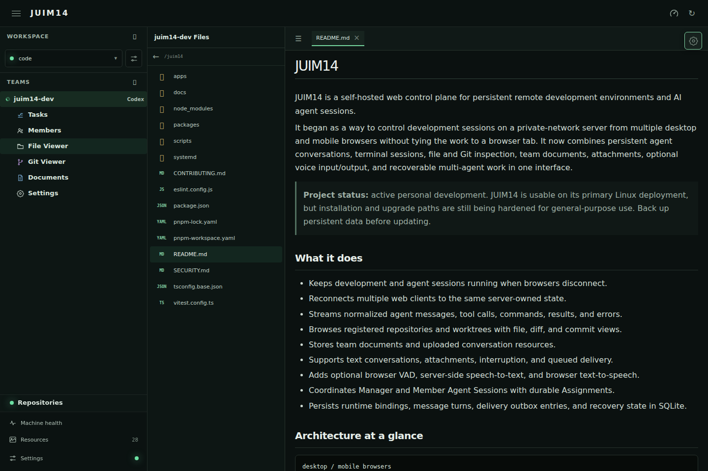
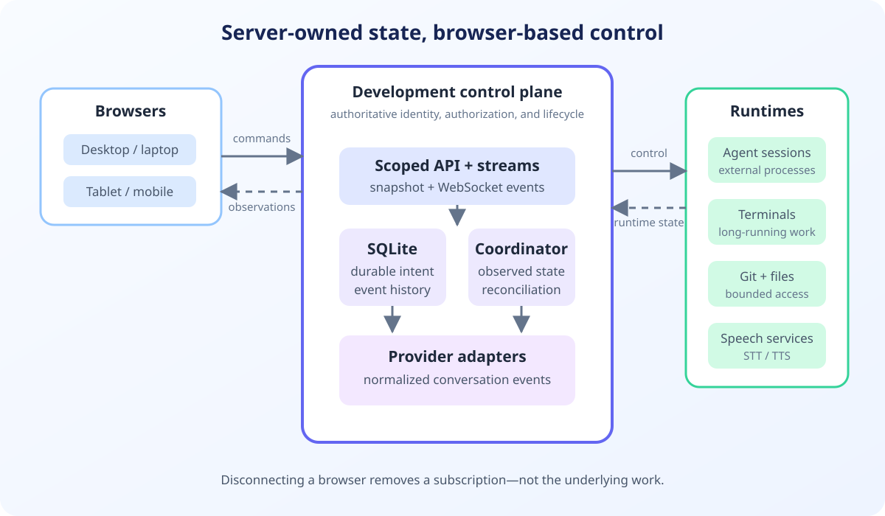
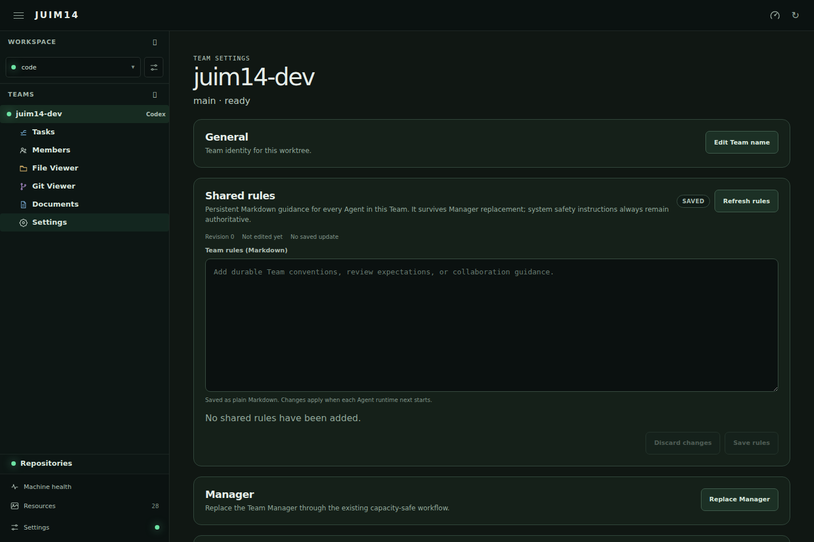
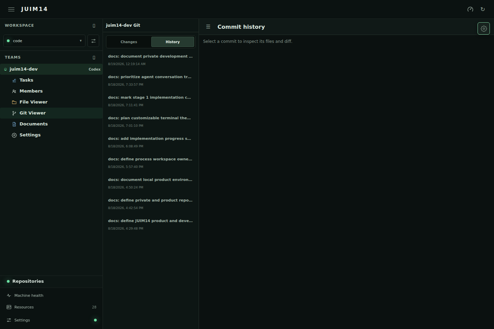
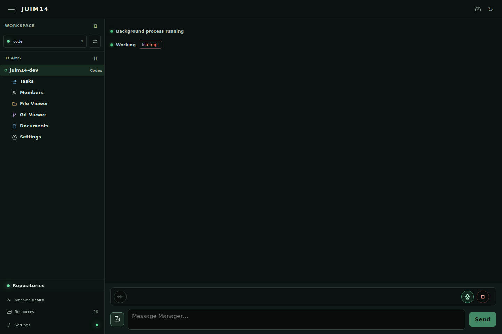
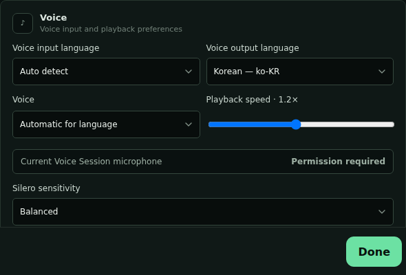
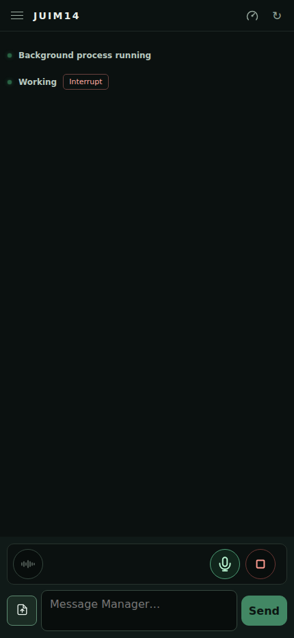

I built a web-based control plane for managing a development server on a private network. It keeps repositories, worktrees, long-running processes, development tools, and AI agent sessions accessible from desktop and mobile browsers while the actual work remains on a server I control.

The project is not yet a general-purpose product. It has been designed and tested around my Linux-based development environment, and broader installation, permission, compatibility, and recovery scenarios still need more work. Nevertheless, it has become a system I use for real development rather than a prototype built only for demonstration.

This post is about how that system evolved: from remote development control, to persistent AI conversations, to a major data-model redesign, and finally to a conversational interface with voice input and output. More importantly, it is about the engineering process I developed after rapid AI-assisted implementation repeatedly produced locally correct features but globally unsafe architecture.

*The file viewer keeps repository inspection inside the same interface as development sessions.*

## The starting point: a browser should control work, not own it

The initial problem had little to do with AI. I wanted to control a development server through a browser over a private VPN network. SSH was sufficient for individual commands, but it was not a satisfying interface for managing several projects and long-running sessions across a desktop, laptop, tablet, and phone.

The requirements were straightforward to describe but difficult to combine correctly:

- the same environment should be available from multiple browsers;
- closing a tab must not terminate a process;
- reconnecting from another device should recover the same state;
- repositories, worktrees, files, Git state, and processes should share an explicit ownership model;
- access to hosts and filesystem roots should be narrowly constrained; and
- the mobile interface should remain useful rather than merely render a compressed desktop layout.

The central architectural decision was to make the server authoritative. A browser does not own a terminal, an agent process, or a long-running operation. It subscribes to state owned by the backend and sends commands to that state. Disconnecting therefore removes a client subscription, not the underlying work.

That distinction shaped the rest of the system. Persistent data lives in SQLite, runtime processes remain server-owned, and clients combine an initial snapshot with scoped WebSocket updates. The interface can be reopened without pretending that a new browser connection created a new development session.

*Browsers observe and control server-owned state; they never become the lifecycle owner of a process or agent session.*

*A team defines the worktree, shared rules, and session lifecycle for one development scope.*

## Adding AI as a development interface

Once the remote-control foundation was useful, I integrated AI agent runtimes. I did not want a separate chat application sitting beside the development environment. The agent needed to operate within the same scope as the repository, files, Git state, documents, and long-running processes.

Different agent runtimes expose different event shapes and lifecycle semantics. Their output may include text, reasoning summaries, tool calls, command execution, errors, or process-state changes. Rendering their raw terminal output would have coupled the UI to provider-specific formatting and made recovery unreliable.

I instead introduced a normalized event track. Provider adapters translate runtime output into a common set of conversation events. Durable events are stored before being published to connected clients, and each event has a stable identity so that history loading and live streaming can be merged without duplicating messages.

This also forced an important separation between three concepts that initially looked similar:

1. **Conversation history** is the durable timeline shown in the UI.
2. **Provider context** is the model's active context, which may be compacted or reconstructed.
3. **Runtime state** describes whether the process is working, waiting, running background work, stopped, or missing.

A quiet conversation does not prove that a process is idle, and a message claiming completion does not prove that the runtime has stopped. Treating chat text as process state caused ambiguous recovery behavior, so runtime state became its own authoritative stream.

## Reliable messaging was harder than rendering chat

The most visible symptom of an incorrect message model was a user message stuck in `Waiting`. The UI had accepted it, but the provider had not necessarily started a turn. Retrying carelessly could create duplicate turns; assuming delivery could silently lose the message.

I redesigned delivery around explicit states. A message is accepted into a durable path, queued for a specific session, acknowledged when the runtime takes ownership, and reconciled after reconnection. Stable client-message identities prevent a reconnecting browser from submitting the same message twice.

Interruption required the same level of care. Pressing Escape is not merely a UI event: it must target the correct runtime generation, stop active work when possible, and preserve a queued user message without delivering it twice. Hot reloads and process restarts exposed stale runtime bindings that had looked valid in the database but no longer pointed to a live process. Recovery therefore needed to reconcile persisted intent with observed runtime state instead of trusting either source in isolation.

This was the point where the project stopped being “a chat UI for a command-line tool” and became a distributed state problem, even though every component ran on one private server.

## Feature growth exposed the wrong schema

As I added repositories, worktrees, teams, manager and member sessions, assignments, documents, resources, Git inspection, and account status, the early schema grew feature by feature. Each addition made sense locally. Together they created overlapping ownership relationships and expensive reconciliation paths.

The critical failure was not a single bad query. AI-generated consistency checks repeatedly scanned broad portions of the database to reconstruct relationships that should have been explicit. A workspace request could trigger relationship repair beyond the workspace being viewed, while overlapping detail streams performed their own reconciliation. When the API slowed down or terminated, reconnecting clients repeated those broad reads and amplified the load. The checks appeared defensive in isolation, but together they created the same class of outage more than once.

Other failures revealed the same underlying problem:

- a migration removed a column while older CRUD code still referenced it;
- workspace detail and team streams returned overlapping data with different refresh behavior;
- deleting an owner before its sessions had a defined lifecycle left stale runtime records;
- persisted bindings survived a server restart even when the external process did not; and
- concurrent feature work reintroduced contract fields that another change had removed.

Adding retries or more validation would not have fixed this. The system needed clearer ownership boundaries.

I redesigned the model around lifecycle rather than screens. A workspace owns registered repositories. A repository owns worktrees. A team owns one development scope and its sessions. Agent sessions own runtime identity and conversation history. Assignments represent bounded coordination between sessions rather than becoming a second task-management system. Documents and uploaded resources belong to explicit scopes instead of being inferred from whichever page opened them.

The WebSocket design changed with the schema. Broad polling and overlapping detail requests were replaced by scoped streams. A workspace stream carries workspace-level structure, while a selected team subscribes to the session state it actually needs. The goal was not only fewer network requests; it was to make every update answer the question, “Who owns this state, and which clients are entitled to observe it?”

## How I changed my way of working with AI

At the beginning, I often described a feature and allowed the agent to determine both implementation and structure. That was fast while the project was small. It became dangerous once a change crossed database migrations, contracts, API routes, runtime coordination, WebSocket payloads, and React state.

The repeated outages changed my role in the process. I did not respond by manually writing every line. Instead, I took direct ownership of interfaces and schemas.

My workflow became:

1. inspect and report the current schema, ownership relationships, and runtime path before editing;
2. identify every contract, migration, API, stream, and UI consumer affected by the change;
3. decide the ownership boundary and compatibility strategy myself;
4. assign one owner to shared contracts and migrations so concurrent work cannot rewrite them independently;
5. implement in bounded phases, keeping the live API compatible for as long as possible;
6. verify both a fresh database and an upgraded existing database; and
7. inspect the resulting schema and interfaces again rather than accepting a successful health endpoint as proof.

This is a different form of hands-on engineering. I was not merely approving generated code, nor was I delegating architecture to a model. I used AI to accelerate investigation and implementation while requiring the system's contracts to remain explainable to me.

The most useful review questions were architectural rather than stylistic:

- Can this state be derived from one authoritative source?
- Is this relationship represented explicitly or reconstructed through scans?
- What survives a process restart, and what must be observed again?
- Can a migration leave the running application in an intermediate incompatible state?
- Does a stream publish an entity it owns, or a convenient mixture assembled for one page?
- Can delivery, interruption, and reconnection occur twice without creating two turns?

Those questions prevented more defects than reviewing isolated implementation details.

## Integrating development tools into the same scope

The browser interface grew beyond conversation because an agent's claims are not sufficient evidence of a code change. I added file inspection and a read-oriented Git viewer so I could examine the worktree, changes, and commit history without leaving the selected development scope.

*The Git viewer exposes bounded status, diff, and commit history without making the browser a Git runtime owner.*

The Git view deliberately remains read-oriented. Destructive operations belong in an explicit agent or terminal workflow where their command and scope can be reviewed. Repository paths are resolved from registered workspace data and checked against allowed roots rather than accepted directly from arbitrary browser input.

This separation is representative of the whole design: the UI provides observation and scoped control, while the server owns identity, authorization, and lifecycle.

## From text chat to a voice-enabled development session

After text messaging, attachments, queuing, and interruption had a reliable path, I added voice interaction. Voice input is not a separate command system. A confirmed transcript enters the same delivery pipeline as typed text.

*Runtime state, interruption, text input, and voice controls share one conversation view.*

The browser runs voice activity detection locally. Microphone frames stay in the browser until an utterance is finalized; only the completed audio segment is uploaded for server-side speech-to-text. This reduces unnecessary network traffic and avoids continuously streaming ambient audio.

Voice output introduced a different class of state problem. Agent responses are normalized into speakable chunks and queued in order. If the user starts speaking, tentative voice activity pauses playback without immediately destroying the queue. Only a credible finalized transcript confirms barge-in, cancels stale speech, and sends the new message. Generation identities prevent late browser callbacks from replaying cancelled audio.

*Input language, output voice, playback speed, sensitivity, and notification volume are independently configurable.*

Mobile constraints mattered throughout this work. The voice interface could not replace the text composer or occupy the entire screen. It became a compact panel above the existing input, preserving the same session and runtime state available on desktop.

*The mobile layout retains runtime visibility, interruption, file attachment, text input, and voice control.*

By this stage, the earlier failures had become design constraints rather than a separate list of edge cases. A persisted runtime identifier was no longer proof of a recoverable process; the coordinator had to observe the external process and reconcile it with stored intent. Bounded snapshots complemented WebSocket delivery so a client could recover after a long disconnection, and expensive consistency checks moved out of frequently requested paths.

Deployment and verification followed the same ownership model. I treated a migration, its shared contracts, API routes, streams, and frontend consumers as one change. I tested both fresh installations and upgrades, then exercised live streams, message delivery, runtime recovery, and the production build. With explicit schemas, lifecycle rules, and acceptance criteria in place, AI-assisted implementation became faster to review and less likely to compensate for unclear ownership with more runtime inference.

## Where the project stands

The system now provides a persistent web control plane over a private development server, with repository and worktree inspection, durable agent conversations, scoped real-time state, recoverable message delivery, attachments, documents, Git history, and optional voice interaction across desktop and mobile clients.

It is still tailored to my environment, not a finished general-purpose platform. That limitation is intentional to state clearly: the interesting outcome is not that every deployment problem has been solved, but that the project has crossed the boundary from a quickly assembled personal tool into a system whose ownership model, runtime behavior, and failure modes I can explain and evolve deliberately.

Building it changed how I work with AI-assisted development. I still use agents extensively, but I no longer treat rapid code generation as a substitute for system design. I ask them to investigate, implement, and verify within boundaries I can reason about. The schemas, interfaces, lifecycle rules, and acceptance criteria remain mine to own.

That shift—from delegating code to directing a system—was the most important result of the project.
